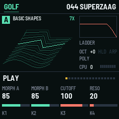

# Golf for the M-VAVE FM-1

A firmware that turns the M-VAVE FM-1 into a wavetable synthesizer with a step sequencer. Free and open source.

**Install it from the browser: <https://barnir.pages.dev/golf/>** (Chrome or Edge, a USB cable, about a minute).

Golf is Dutch for wave. It is not a port of the Golf plug-in: the sound engine was written from scratch for the FM-1's
chip (a JieLi AC79: 360 MHz, two cores, single-precision floats only, no maths library). It uses the plug-in's
wavetables, and 96 of its presets, converted and then fitted against recordings of the plug-in.

Nederlands: [README.nl.md](README.nl.md).

## What it does

- **Two oscillators** that each morph through a wavetable: 130 tables built in, room for 32 of your own. Up to seven
  unison voices per oscillator, and a warp: sync, bend, asym, PWM, fold or FM.
- **Sub and noise**, a **filter** (ladder 24 dB, 12 dB, band, high, acid) with resonance, drive, its own envelope and
  key tracking.
- **Movement**: two envelopes, two LFOs, six modulation routes. Sources: mod envelope, both LFOs, velocity, key
  pressure, mod wheel, pitch and chance.
- **Step sequencer**: 32 steps, up to four notes per step, velocity, gate (with ties), swing, and per step its own
  wavetable position and filter offset. It runs inside the audio engine, so it is tight, and the arpeggiator can play
  its chords.
- **Effects**: drive, three-band OTT compression, chorus, delay, reverb. An arpeggiator; mono and legato with glide.
- **Eight notes**, spread over the FM-1's two processor cores. 168 presets and 16 slots for your own.

## Controls

| | |
| --- | --- |
| keys | play, with velocity and pressure |
| OCT-, OCT+ | octave (on release); both together: hold notes |
| PRESET | choose a preset (sorted by kind); SAVE stores the current sound in one of 16 slots |
| K1 to K4 | the four controls of the page; ALGORITHM steps through the pages |
| SELECT or SEL | oscillator A or B |
| HOME | PLAY page: morph A, morph B, cutoff, resonance. Again: the next kind of preset |
| EDIT | the oscillator: WAVE, SHAPE, TUNE |
| GLO | MIX and VOICE (poly/mono/legato, glide, volume, tempo) |
| ENV | FILTER, FILTER ENV, AMP ENV, MOD ENV |
| LFO | LFO and MATRIX |
| FX | EFFECTS and SPACE |
| ARP | arpeggiator on or off, and its page |
| SEQ | the sequencer: STEP (note, velocity, gate, morph) and PATTERN (length, rate, swing, filter). SELECT picks the step |
| PLAY | hold notes. On the sequencer pages it starts the sequencer; while it runs, it stops it. While it runs a key transposes it (C4 = as recorded) |
| REC | step record: every key or chord fills a step and moves on, SEL writes a rest. Hold for a second: clear the pattern |

SAVE on a sequencer page stores the pattern. MIDI: notes, pitch bend, mod wheel, sustain, pressure, program change;
CC 102 selects a parameter (its offset in `gf_patch_t`) and CC 103 sets it; CC 105 shows the load on the screen.

## Your own wavetables

A table is a wavetable WAV as Serum, Vital and Golf store them (frames of 2048 samples).

    python3 eigen/tools/golf_tabellen.py bank mine.gfb A.wav B.wav     # needs numpy and scipy
    python3 eigen/tools/golf_tabellen.py stuur mine.gfb                # needs mido; sends it over USB MIDI

The bank survives a firmware update. `eigen/bank/extra.gfb` is an example.

## Layout

| | |
| --- | --- |
| `eigen/dsp/` | the sound engine: `gf_engine.c` (voices, filter, effects, sequencer), the tables and the presets |
| `eigen/app.c` | the instrument: screens, buttons, storage, MIDI |
| `eigen/test/gf_host.c` | measurements of the engine on a computer (aliasing, clicks, levels, timing) |
| `eigen/tests/` | simulator tests: button presses and expected screens |
| `eigen/tools/` | wavetable packing, the wavetable bank, converting and fitting the plug-in's presets |
| `firmware/` | the built packages |
| `luister/` | listening examples |
| [LEARNINGS.md](LEARNINGS.md) | what worked, what did not, and the measurements (Dutch) |
| [TABELLEN.md](TABELLEN.md) | the wavetables and their sources |

## Building

You need [fm1-base](https://github.com/charlesvestal/fm1-base) (it explains the toolchain; the device build runs in
Docker). Set `FM1_BASE` to its checkout.

    cd eigen
    ./bouw.sh host                          # the simulator; runs tests/*.txt
    ./bouw.sh device --no-ble               # build/golf.fwsc
    ./bouw.sh device --no-ble --release 1.0 # a release package
    cc -O2 -ffp-contract=off -I $FM1_BASE/include -o build/gf_host test/gf_host.c dsp/gf_engine.c -lm
    build/gf_host                           # engine measurements
    build/gf_host demo build/demo           # a listening example of every preset

Install a package from the command line with fm1-base's `tools/fm1_install.py golf.fwsc --yes`. Back to the stock
firmware: the install page has a button for it.

## Licence and credits

The code is under the [Mozilla Public License 2.0](LICENSE). Built on
[fm1-base](https://github.com/charlesvestal/fm1-base) by Charles Vestal and felucca-bsp, from Felucca by Leo Kuroshita
(Hügelton Instruments). The wavetables are Golf's own, and resyntheses of CC0 and CC BY sources: see
[TABELLEN.md](TABELLEN.md).

Not affiliated with M-VAVE. Installing other firmware on your FM-1 is at your own risk.
